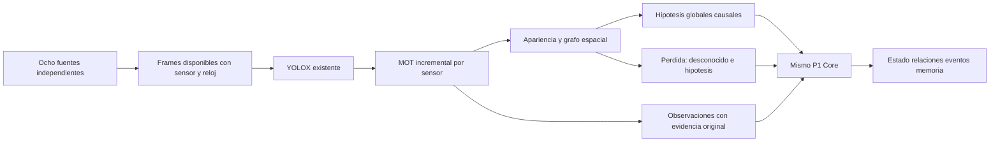

# P2-09.19 — Diagnóstico y propuesta de percepción causal continua

**Estado actualizado, 2026-11-12:** el operador aprobó esta propuesta con «aceptado», después de su publicación en7704624. Implementación autorizada en curso, incluidos los presupuestos propuestos; no demostrado todavía el gate sostenido causal a16 imágenes/s. La aceptación humana final de09.18/P2-09 sigue pendiente. Las secciones de propuesta y solicitud siguientes conservan el contexto del diagnóstico original; su autorización ya fue recibida.

## Conclusión

### Avance tras la aprobación del operador

La aprobación recibida autoriza la implementación y los presupuestos propuestos; no constituye aceptación del resultado. El nuevo camino es optativo y conserva el batch como referencia. `edge.causal_presence` exige frame/hash, sensor, sesión, calibración, reloj, estado candidato/confirmado y disponibilidad; `edge.causal_association` representa revisiones con referencias ya persistidas, versión esperada y alias explícitos. Core no admite identidad civil ni pose mundial en este contrato. Su validador comprueba referencias/tiempos/procedencia; no vuelve a ejecutar visión ni certifica que una asociación sea correcta.

Las consultas distinguen presencia visual de localización mundial. Las revisiones globales se conocen en su hora de decisión; los eventos y la reconstrucción histórica conservan el estado anterior. Los alias son relaciones `supersededBy`, y las relaciones visuales anteriores cierran su vigencia también en la proyección del Core original. Un lote tiene hasta32observaciones recibidas, con atomicidad, autorización y deduplicación individuales. La lectura causal carga recursos pertinentes de la transacción y no ejecuta la proyección de rutas del simulador. Se mantienen SQLite y durabilidad existentes.

El worker nuevo recibe un frame independiente por protocolo binario stdin, con cola de decodificación de2frames; no monta corpus/evaluador/workspace ni tiene red. YOLOX conserva umbral0.25, recortes C1/C2 y pesos. OSNet CUDA usa los mismos pesos; su calidad integral continúa en evaluación. Norfair emite candidatas frescas y confirma después, sin editar salidas previas. La confirmación puede incorporar una candidata anterior a la inferencia actual, conservando su captura original y haciendo explícita su disponibilidad posterior. MTMC retiene historia acotada y candidatas/alias/revisiones, sin usar número esperado de actores. La tolerancia temporal optativa0.25s compara capturas independientes con su delta real; el batch conserva su sincronización exacta.

Los relojes se distinguen: `observed_at` de captura; `known_at` de disponibilidad/decisión; `received_at` del manejador Core después de autenticación/parsing; `office_events.recorded_at` de inserción. El ACK causal incluye `commit_ack_at` después de salir de la transacción; este es un límite posterior al commit, no la hora exacta del fsync. Un replay tiene un ACK nuevo, sin nuevos efectos. El replay usa UTC de escenario más tiempo monotónico transcurrido y declara `paced-replay-utc`; no confundirlo con fecha real de recepción/persistencia. Las latencias reportadas van de liberación programada del frame al ACK HTTP real.

**Resultados intermedios, no gate:**smoke2 persistió109/128frames,19descartes,p95=2369.66ms; smoke4 persistió320/320sin descartes,p95=1422.19ms; smoke5 persistió320/320sin descartes,p95=1205.92ms. Son variantes de desarrollo, con carga del host no controlada y umbral incorrecto0.10 entonces: no comparables a calidad congelada ni prueba sostenida. La primera regresión completa reg-v0a preservó2008frames pero mostró retraso acumulado y fragmentación; el umbral fue corregido a0.25 y su repetición sigue pendiente. Se conservan los intentos, no se escogen solo muestras favorables.

**Captura:** probe nativo nuevo comprueba0diferencias de canal entre PNG y BGR en8×1259712píxeles. BGR render/read p50=14.2ms, pero envío binario local p50=167.8ms; evitarPNG no fue una mejora global. Grupos de PNG1/4/8 enRPC producen11.83/13.82/13.06imágenes/s en muestras cortas; no se adopta un transporte como solución sin medirlo. La fuente virtual integrada y el ensayo10min/16FPS/p95≤1s siguen pendientes.

**Primer recorrido corregido completo, reg-v0b:**2008imágenes recibidas/inferidas/persistidas,503/513oportunidades válidas(98.05%),8observaciones falsas/duplicadas contando también candidatas. Los24tracks del actor que llegaron a confirmarse localmente convergen por alias en1hipótesis corroborada. Hay8hipótesis finales totales: además de la corroborada,7candidatas;3de estas contienen1/1/2observaciones parciales del actor sin confirmación local. No son8personas ni se borran candidatas conGT. El indicador de cambios locales sobre TODAS las candidatas registra1; no presentarlo como0. Latencia acumulada p95=9957.55ms,2008/140.49s=14.29img/s con contrapresión: **no cumple rendimiento**. Replay exacto y hashes de mundos anteriores invariantes. Los otros cuatro corpus corregidos están bajo supervisor`causal19-quality-status.json`; no relanzar sin inspeccionar sus marcadores.

El límite principal es arquitectónico: el circuito actual espera archivos completos entre etapas y decide asociaciones usando observaciones futuras. Acelerar YOLOX no convierte ese diseño en causal. Hay además costes medidos en captura/PNG/transporte, recortes de YOLOX, OSNet CPU y reconstrucción/persistencia Core. **La evidencia no permite declarar saturada la GPU ni justificar una compra o sustituir todo el motor.**

Recomiendo conservar pesos, sensores/calibración, grafo, Norfair y el mismo Core como componentes probados; sustituir el recorrido de datos y la asociación retrospectiva por procesamiento incremental con evidencias disponibles ahora. La referencia batch se conserva como regresión, no como funcionamiento operativo final. Optimizar después los servicios medidos dentro de ese circuito causal y comprobarlo en una ejecución real única.

## Qué revisé y medí

Se revisaron captura nativa, manifiestos, detect-cctv.py/YoloX, cctv_mot.py, cctv_reid.py, cctv_mtmc.py, ingreso HTTP, contratos y office.storage/world/emit. Se ejecutaron probes nuevos con componentes reales:24 capturas RGB temporizadas tras calentamiento,64 frames/160 llamadas YOLOX,32 recortes OSNet CPU/CUDA, lecturas de la SQLite existente y24 ingresos HTTP instrumentados sobre el mismo P1. No se alteraron los resultados ni la política congelada 09.18.

| Medición nueva | Resultado | Qué permite concluir |
|---|---|---|
| Captura RGB nativa, PNG y transferencia navegador→Node | p50 79.23 ms, p95 102.93 ms;24 llamadas suman 1999.15 ms | El recorrido serial corto ronda 12 imágenes/s, sin fichero/amodal. No demuestra capacidad sostenida ni latencia E2E. |
| Interior del capturador en navegador | p50 49.20 ms | Parte del coste queda dentro de render/lectura/PNG; el resto del roundtrip no es tiempo de kernel GPU. |
| Renderer de este probe | Intel UHD, ANGLE/D3D11 | Captura y CNN no usan necesariamente la misma GPU. No extrapolar este dato a capturas históricas sin registro. |
| Inicialización de fondos |34.46 s excluidos del steady probe | Cold start y régimen estable son métricas distintas. |
| Lectura+SHA / decodificación PNG, frames ext4 | p50 3.11 /21.41 ms | El archivo/codec tiene coste real, aunque el PNG sea evidencia válida. |
| YOLOX host Run() | p50 15.17 ms;160 llamadas en 64 frames | Incluye transferencias/sincronización; no es ocupación de kernel ni prueba de saturación. |
| Detector por sensor, preprocess+run+postprocess | vistas simples~18–22 ms;C1/C2~135–136 ms p50 | C1/C2 ejecutan 7 redes por frame: vista completa+6 recortes. El probe excluye NMS global final. |
| OSNet red CPU /CUDA | p50 97.17 /19.05 ms en 32 recortes | Hay una alternativa computacional reutilizando los mismos pesos. No está integrada ni aprobada para producción. |
| Paridad OSNet de esa muestra | error máximo normalizado 2.91e-7; coseno mínimo 0.99999994 | Control acotado de implementación; no prueba calidad ReID en todos los casos. |
| Modelos ONNX actuales | entradas[1,3,640,640] y[1,3,256,128] | El batch actual es estático 1; no basta concatenar 8 imágenes. |
| Core HTTP real,24 mensajes nuevos | p50 113.33 ms, p95 171.53 ms | El recorrido serial actual de ingreso no garantiza 16 mensajes/s. No es una prueba de saturación/concurrencia máxima. |
| Dentro de esos mensajes:world /emit | p50 53.24 /22.30 ms | Reconstruir todo el mundo y proyectar eventos forma parte relevante del ruta crítica. |
| Contexto escritura:body /commit+close | p50 83.62 /13.72 ms | No atribuir todo a fsync. world/emit están incluidos en body: no sumar tiempos anidados. |
| LecturaCore tras completar09.18 | world p50 13.82 ms con conexión retenida,80.66 ms con conexión nueva | El patrón de lectura/conexiones/caché merece medirse; no aisla por sí solo el coste de connect(). |
| SQLite existente | journal DELETE, synchronous 2(FULL), fichero bajo/mnt/c | Es un escritor transaccional serial, no una cola paralela ilimitada. No se cambió su durabilidad. |

Los JSON completos, tamaños de muestra, comandos y limitaciones están en [evidencia09.19](spatial-simulation/evidence/p2-09/09.19/README.md). Son probes cortos con host no dedicado. La lectura bajo actividad concurrente y la posterior a su finalización se conservaron por separado. Los percentiles de muestras pequeñas son descriptivos, no garantías de cola.

Para ocho sensores a 2 FPS entran16 imágenes/s: presupuesto medio62.5 ms porimagen si un servicio fuese estrictamente serial. El perfil actual necesita20evaluacionesYOLOX por grupo de 8 imágenes, es decir40 llamadas/s al objetivo, por los recortes. Esto mide demanda del diseño, no demuestra que la GPU esté al100%. El ingresoCore también tiene un tramo serial incompatible con resolverlo únicamente añadiendo threads o colas.

## Por qué ahora no es causal

1. **Captura/exportación:** cctv-trial.mjs produce el manifiesto al final y añade un renderamodal por frame para el evaluador. Ese pase es legítimo para la prueba, pero no debe bloquear la entrada operativa de ENTITY. El tiempo de medios programado no equivale a exposición real simultánea de ocho cámaras.
2. **Barreras por archivo:** cada worker lee la salida completa del anterior y escribe su JSON al terminar. No existe un productor de frames con entregas progresivas al mismo motor/Core. La orquestación de 09.18 solapa ensayos distintos, pero cada ensayo sigue siendo retrospectivo.
3. **MOT:** Norfair puede actualizarse por frame, pero el adaptador actual almacena y reescribe asociaciones de detecciones tentativas cuando se confirman después. Preserva timestamps, lo cual sirve para auditar batch; no constituye entrega causal. En vivo deben emitirse observación/candidata y confirmación posterior como conocimientos diferentes. La confirmación inicial puede preceder detecciones posteriores del mismo track.
4. **ReID:** se extrae apariencia de todas las observaciones después del MOT completo. La apariencia puede calcularse progresivamente, pero el código actual no la entrega así. Calcularla en cada frame tiene un coste medido; frecuencia/caché son decisiones a validar, no motivos para fingir evidencia nueva.
5. **MTMC:** associate() compara tracklets completos, medianas de solapamientos, fronteras futuras, contradicciones de todos los pares y secuencia completa antes de formar componentes. Eso usa información que no estaba disponible al principio. Cambiar solo el bucle o la etiquetaexecution_mode no lo vuelve online.
6. **Core:** el ingreso se hace cuando ya existe global-tracks.json; adelanta el reloj del run para importar un lote histórico y persiste la asociación global al final. Es una prueba real de Core, no la operación continua deseada. Sus evidencias y memorias válidas no demuestran latencia de captura a estado operativo.

La tasa4.42de 09.17 y las tasas derivadas09.18 son sumas de etapas con inferencia reutilizada, no FPS de una ejecución continua única. No las usaré como diagnóstico de saturación ni como aceptación de 09.19.

## Coherencia del mundo, además de velocidad

En09.18 el actor tiene continuidad, perov2/v3 conservan una candidata global falsa/duplicada adicional cada uno: no son dos personas. Deben diferenciarse candidata, asociación corroborada y persona civil. No contar todas las hipótesis como ocupantes ni fusionarlas porque el evaluador sabe que hay un actor. Memoria y relaciones deben conservar también revisiones/rechazos, con su instante de conocimiento.

Hay otro resultado concreto: una consulta location sobre un track local activo en coordenadas normalized-image devuelve status=confirmed yzone_id=null. No inventa una zona, pero el término confirmado puede confundirse con ubicación mundial. La identidad global actual devuelve unknown correctamente. Propongo explicitar presencia visual por sensor, ubicación mundial observada/inferida/desconocida e identidad civil por separado. No convertir una caja ni una región de soporte en una posición mundial confirmada.

En el Core examinado no existe la tabla de rutas del simulador. Los scripts genéricos de P1 pueden proyectar poses desde rutas en otros usos de simulación; esa capacidad no debe incorporarse al camino CCTV para resolver continuidad. El grafo restringe hipótesis; los píxeles aportan evidencia. La inteligencia compartida conserva procedencia y límites, no recibe la respuesta del dummy.

## Propuesta que someto a aprobación

**Conservar:** ocho feeds separados, calibración/grafo/modelos, detecciones frescas, Norfair como componente, modelo del mundo/contratos y persistencia P1, precedentes de idempotencia y regresiones. La implementación continúa en los adaptadores P1, con la escena y pruebas en P2; no se crea otro Core ni otro detector desde cero.

**Cambiar el flujo temporal:** entregar frames conforme existen y mantener estado local por sensor e hipótesis globales entre llegadas. La asociación solo usa evidencias disponibles hasta esa decisión, con candidatas cuando falta información. Una evidencia posterior puede confirmar, unir mediante alias o revisar una hipótesis mediante un nuevo evento; no reescribir el pasado como si se supiera antes. No rellenar pérdidas con posiciones observadas ni inferir una salida por silencio.

**Cambiar el contrato donde lo exige la semántica:** distinguir tiempo observado, recepción, disponibilidad de confirmación/inferencia y persistencia; introducir modo causal explícito, no enviar batch disfrazado. El enrolamiento describe sesión/calibración/reloj de stream, sin necesitar el manifiesto final. Conservar sensor/stream/frameID/hash y referencias hasta Core. Resolver el reloj del run sin una llamada administrativa por frame y sin adelantar todo al final. Las consultas deben separar evidencia visual de ubicación mundial. La revisión no confirma identidad civil ni añade integraciones externas.

**Dar presupuesto al flujo:** medir esperas por etapa, edad de frame y deltas temporales reales. La retención del MOT hoy se expresa en frames a 2 FPS; jitter, frames perdidos y reconexiones requieren pruebas de tiempo transcurrido. Una cola no corrige falta de capacidad; un descarte debe quedar contado y no eliminarse del denominador de calidad. Cualquier agrupación corta contendrá solo frames ya disponibles, conservando sus identidades; nunca un panorama ni un lote que espere al final de la película.

**Optimizar según los probes, no por preferencia tecnológica:**

- Sacar PNG/ficheros del intercambio operativo cuando la medición lo justifique; conservar archivo/hash de evidencia fuera del tramo crítico. Comparar transferencia RGB/PNG y llamadas por sensor frente a un envío de vistas ya disponibles. La captura actual usa Intel y la CNN en NVIDIA; medir esa frontera, no suponer un únicoGPU.
- Probar OSNet CUDA con los mismos pesos y todos los recortes/regresiones; el probe de 32muestra paridad, no autoriza una sustitución sin comprobar calidad. Evaluar frecuencia/caché de apariencia por evidencia, preservando su edad; no crear embeddings nuevos de predicciones.
- Evitar reconstruir493 entidades para cada mensaje si el dominio necesita solo estado relevante; o evaluar una transacción acotada con observaciones independientes ya recibidas. Mantener autorización, observaciones individuales, idempotencia y efectos de dominio. Medir mejora de estado persistido, no solo un ACK temprano a una cola.
- Comparar conexiones/consultas/proyección/commit en ejecución real. No empezar bajando synchronous, migrandoDB o comprandoGPU. SQLite WAL puede mejorar ciertas interacciones, pero sigue teniendo un escritor; el perfil actual muestra53 ms en world frente a 14 ms en commit/close. WALsolo no resuelve causalidad ni todo el coste.
- Conservar tiling como referencia de calidad. Batching/FP16/TensorRT/otro backend son alternativas condicionadas a perfiles y paridad/recall, no decisiones ya tomadas. Las entradasONNX actuales sonbatch 1. Evitar una migración completa a DeepStream sin demostrar que soluciona el límite medido y sus costes.

**Alternativas descartadas como solución suficiente:** acelerar el batch y llamarlo vivo; aumentar threads manteniendo un escritor y reconstrucciones por frame; reducirFPS por debajo del objetivo para ocultar retraso; fusionar tracks por saber que hay una persona; usar poses del simulador. Ninguna cumple el objetivo operativo.

## Implementación y aceptación propuestas, después de aprobación

1. **Instrumentar y fijar contratos temporales.** Medir en una ejecución única recepción→detección→MOT→apariencia/asociación→estado/memoriaCore, separando tiempo de servicio y cola. Establecer correlación por sensor/frame y relojes; incluir arranque/frío y régimen estable. No presentar suma de ejecuciones anteriores como latencia E2E.
2. **Prueba de causalidad antes de optimizar.** Alimentar prefijos progresivos del corpus. Añadir o cambiar frames futuros no puede alterar eventos ya emitidos; una revisión solo aparece cuando llega su evidencia nueva. Validar candidatas/confirmaciones, orden por sensor, pérdidas y memoria. Mantener el batch como oráculo de regresión etiquetado retrospectivo.
3. **Adaptar el camino incremental y medir capacidad real.** Aplicar los cambios mínimos que resuelvan los límites medidos de captura, cómputo y Core, con benchmarks separados cuando discriminen hipótesis. Reusar código útil y versiones comparables; no imponer una reescritura total ni un patrón de colas antes de verificarlo.
4. **Ensayo sostenido con ocho fuentes a 2 FPS y un actor.** Replay causal a ritmo real y después capturador virtual integrado, claramente diferenciados. Propuesta inicial:10 minutos estables a 16 imágenes/s agregadas, latencia de observación captura→estadoCore p95≤1s y cola acotada. Para asociación, medir desde que existe evidencia suficiente; no confundir espera epistemológica con procesamiento ni forzar identidad para cumplir latencia. Estos presupuestos temporales se proponen para aprobación, no están ya aceptados.
5. **Regresión y fallos.** Cinco corpus09.18 con recall≥95%por ensayo, FP/duplicados y revisiones visibles, continuidad del actor y barreras físicas; prefijos sin futuro, desconexión/reconexión de cámara, entrada duplicada/tardía, reinicioCore/Edge y recuperación sin nuevos efectos. Registrar toda pérdida de frames y medir calidad sobre lo que debió observarse, no solo lo entregado. Auditar GT aislado e IDs privados ausentes. Los mundos/personas previos se conservan.
6. **Presentar evidencia para aceptación.** Solo entonces declarar logrado el gate causal/rendimiento; no equipararlo a despliegue físico/profesional general. P2-06/07/10, doce personajes, CRM/reservas/accesos y P3 siguen fuera del encargo.

## Riesgos y preguntas que quedan abiertas

Las muestras actuales no fijan la utilización GPU, el máximo de concurrencia, la carga bajo ocho streams codificados, p99 sostenido ni el mejor protocolo Windows↔WSL. No se ha elegido backend nuevo ni cambiado el modelo. Microbatch puede ahorrar costes fijos pero añadir espera; caché puede envejecer apariencia; cambios de precisión pueden cambiar decisiones; la asociación online puede necesitar revisiones que el batch resolvía con futuro. Esas tensiones se miden contra calidad/latencia/procedencia, no se ocultan con un ID global forzado.

La confirmación de MOT requiere evidencia posterior y la asociación puede necesitar varias vistas/muestras. Se pueden publicar observaciones y candidatas antes, pero no una identidad ya confirmada sin soporte. Ubicación desconocida y duda de identidad son respuestas operativas válidas. Esta distinción protege el objetivo general de ENTITY: no duplicar personas ni ocupar/liberar recursos por una inferencia injustificada.

## Fuentes y aprobación

Los [probes](spatial-simulation/evidence/p2-09/09.19/README.md) son evidencia local, con hashes de pesos y scopes. La documentación primaria de [ONNXRuntime I/O Binding](https://onnxruntime.ai/docs/performance/tune-performance/iobinding.html) explica por qué Run con entradas CPU puede incorporar copias al dispositivo; no prueba el cuello de botella de esta máquina. [CUDA Execution Provider](https://onnxruntime.ai/docs/execution-providers/CUDA-ExecutionProvider.html) y [profiling](https://onnxruntime.ai/docs/performance/tune-performance/profiling-tools.html) distinguen opciones del proveedor y trazas; contar kernels no equivale a medir ocupación. [SQLite WAL](https://www.sqlite.org/wal.html) conserva un único escritor; sus beneficios y compromisos no sustituyen el perfil actual ni autorizan reducir durabilidad.

El [roadmap vigente](P2-ROADMAP.md), sección 09.19, exige: «Presentarlo al operador antes de implementar una refactorización sustancial». Solicito aprobación de esta propuesta y de los presupuestos de prueba antes de implementarla. El diagnóstico/probes están completados; **la refactorización y el gate de percepción causal continua no lo están**.
