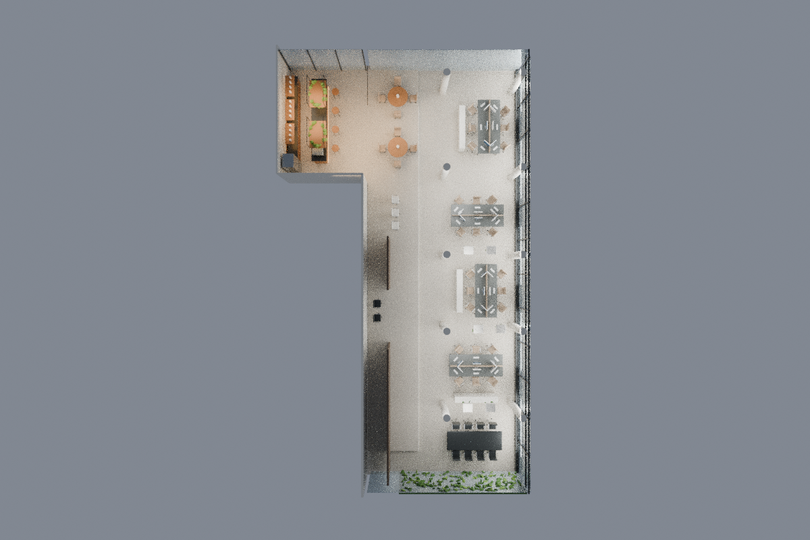
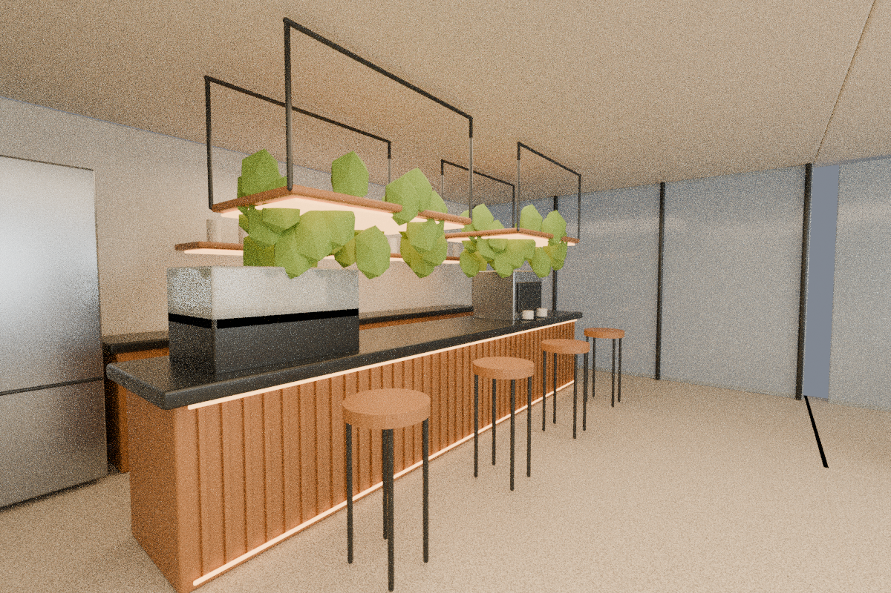

# Corrección del operador: cafetería y planta en L

2026-11-08. Rama `codex/spatial-simulation`, después de `96a2d0a`.

El operador corrige la primera reconstrucción: el edificio no termina como rectángulo largo; tiene un brazo en L en el sector posterior de los pods. Allí va la cafetería y los pods se sustituyen por mesas normales. Esta instrucción autoriza el incremento de cafetería, sin aceptar automáticamente la Fase 01 ni el resto de Fase 02.

## Entrega

- Maestro actualizado: `simulation/spatial-office/output/office-cafe-L.blend`.
- Inventario del incremento: `simulation/spatial-office/output/cafe-inventory.json`.
- Planta: `evidence/cafe-correction/cafe-plan.png`.
- Vista general: `evidence/cafe-correction/cafe-dollhouse.png`.
- Interior: `evidence/cafe-correction/cafe-interior.png`.
- Parámetros y procedencia: `simulation/spatial-office/cafe-layout.json`.

La L se añade en el extremo de descanso, conectado al sector de los pods del archivo original, sin invertir ni trasladar las anclas A–D. En coordenadas fuente el brazo ocupa X−12..−6,5, Z−26,5..−18,2. **Son límites estimados para el diseño**, no medidas recuperadas del Gaussian. «Al fondo a la derecha» se interpreta por el sector de pods indicado por el operador; derecha depende de la vista. La planta publicada permite revisar esta correspondencia. El ala principal y las anclas existentes se conservan.

El diseño incorpora dos mesas redondas, ocho sillas normales, barra con cuatro taburetes, almacenamiento, máquina de espresso, refrigerador, vitrina, estantería negra, revestimiento de madera, vegetación y luz cálida de referencia. Se abre la pared lateral reconstruida para dar continuidad al brazo. El suelo mantiene el nivel elevado del sector y se completa su extremo posterior. No quedan pods reconstruidos en este maestro. Las referencias originales y el maestro de Fase 01 permanecen intactos como evidencia histórica.

## Referencias recibidas

- `references/1212-cafeteria.jpg`: suministrada por el operador; barra de madera, luz integrada cálida, vegetación suspendida y mesas regulares.
- `references/1211-mamparas.jpg`: suministrada por el operador; familia de vidrio de piso a techo y perfiles negros delgados para el siguiente incremento de cerramientos.

Los hashes de ambas imágenes se registran en el inventario. No se presume licencia comercial ni autoría del agente sobre las referencias. Se utiliza su lenguaje visual; no se afirma reproducción fotográfica exacta. La segunda referencia no acredita que las mamparas de todas las salas estén implementadas en esta corrección.

## Reproducir

Desde `/workspace/Entity`, después de disponer del maestro de Fase 01:

```sh
blender -b --factory-startup -t 4 --python-exit-code 1 --python simulation/spatial-office/build-cafe.py
blender -b --factory-startup -t 4 --python-exit-code 1 --python simulation/spatial-office/check-cafe.py
```

Si falta el maestro de origen, ejecutar primero `simulation/spatial-office/build.py` con los mismos argumentos de Blender. Las comprobaciones reabren el nuevo `.blend`, verifican ausencia de pods, mesas/sillas, continuidad y nivel del brazo, paso de trabajo entre barra y almacenamiento, unicidad de IDs y conservación de cada ancla y los 578 archivos originales. Los renders Cycles se guardan con hash del maestro. Iluminación de referencia, todavía sin contratos de circuitos operables.

## Estado

Corrección geométrica y cafetería en validación. Los resultados reales se registran en `evidence/cafe-correction/checks.json` y `renders.json`, junto con los logs de los comandos y la revisión visual. No se afirma circulación completa, colisiones runtime ni Gate 02 integral: puertas, Sala E, cuatro TVs y todos los cerramientos siguen pendientes de esa fase. No hay cambios en backend, frontend previo ni Gaussian.

## Resultado ejecutado

**46 comprobaciones PASS**, tres renders finales inspeccionados y vinculados al hash del maestro; 578 archivos originales y maestro Phase01 byte-idénticos. [Verificación y revisión](evidence/cafe-correction/review.json). En la inspección inicial se detectaron soportes demasiado macizos; se sustituyeron por perfiles finos abiertos y se regeneraron las imágenes. La aceptación visual del operador sigue pendiente; no se autoaprueba el Gate 02 completo.




