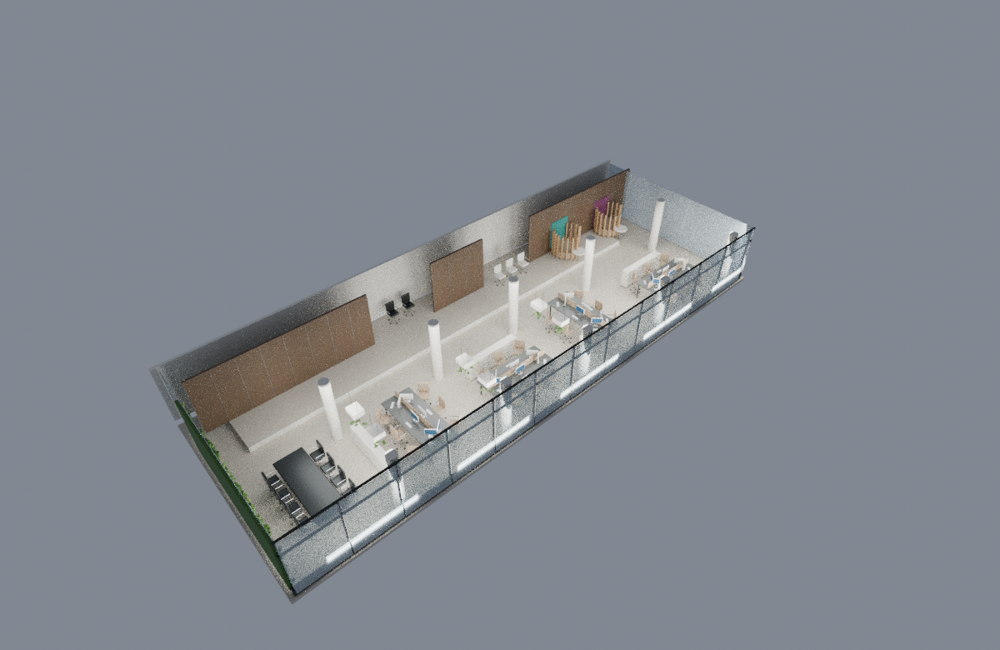

# Fase 01 — reconstrucción editable y Gate 01

Fecha: 2026-11-08, Ecuador (UTC−5). Rama `codex/spatial-simulation`.
Base: `a037bb8fcf9e90e510e364edf00452611a8faed8`. No merge a `main`.
Estado: **EN VALIDACIÓN; aceptación humana pendiente.** Las fases 02–06 no se han iniciado.

Implementación y evidencias publicadas en [`90ea770`](https://github.com/drbrownlabs-afk/Entity/commit/90ea7700b0f8656c9ae4b3bc005aa971ae5cd065), push confirmado en `codex/spatial-simulation`; sin merge ni PR nuevo. Este informe y la bitácora añaden después la constancia documental de publicación. No se afirma CI remoto.

## Qué funciona

- [Maestro Blender comprimido](../../simulation/spatial-office/output/office-phase01.blend): 1.139 objetos catalogados y 14 cámaras. Incluye suelo, techo, paredes/revestimientos, diez columnas cilíndricas estimadas, ventanales/perfiles, mesas A–D, reunión negra junto al muro vegetal, sillas, computadoras, almacenamiento, vegetación, recepción/espera y dos booths representativos.
- [Inventario de objetos](../../simulation/spatial-office/output/object-inventory.json), [parámetros y estimaciones](../../simulation/spatial-office/layout.json) y [constructor reproducible](../../simulation/spatial-office/build.py). Cada pieza tiene ID, tipo, ambiente, material, posición y procedencia; Blender conserva su transformación completa. Colecciones por ambiente y tipo, objetos independientes.
- Las anclas originales están separadas como `ref:*` y los objetos nuevos usan `sim:p1:*`. No se crean entidades Core ni se cambian reservas. A/B no reciben coordenadas Core inventadas para sus sillas; las doce superficies C/D sí conservan sus posiciones fuente.
- El OBJ original se conserva como guía oculta de 16.709 vértices y 29.526 triángulos. Se aplica una sola conversión `(x,y,z)->(x,-z,y)`. El slab de diseño es otro objeto estimado; no se rellenan huecos del archivo fuente. Suelo general Y−1,85 y recepción elevada Y−1,55, sin aplanar ambos niveles.

## Evidencias y gate

| Criterio | Resultado ejecutado | Evidencia |
|---|---|---|
| Archivo `.blend` abre | PASS, reapertura en un proceso Blender independiente, headless | [validation.txt](evidence/phase01/validation.txt) |
| Estructura independiente y metadatos | PASS, 1.139 IDs únicos; prueba de mover una mesa sin arrastrar otros objetos; dimensiones/metadatos y cámaras | [99 comprobaciones](evidence/phase01/validation.json) |
| Transformación y procedencia | PASS, cada vértice/cara del OBJ y cada ancla, superficies C/D, unidades relativas y niveles | [validation.json](evidence/phase01/validation.json), [source-tests.txt](evidence/phase01/source-tests.txt) |
| Reproducción del handoff | PASS, cinco tests; extractor ejecutado solo en copia temporal, resultados byte-idénticos | [source-tests.txt](evidence/phase01/source-tests.txt) |
| Fuentes intactas | PASS, 578 archivos de la base comparados con sus SHA256; cero cambios de contenido | [snapshot](evidence/phase01/protected-files.json) |
| Vistas comparables y capturas | Diez renders Cycles examinados por el agente; distribución reconocible con limitaciones declaradas, aceptación humana pendiente | [comparador](evidence/phase01/comparison.html), [revisión visual](evidence/phase01/visual-review.json), [renders.json](evidence/phase01/renders.json) |
| Rechazo de evidencia incompleta | PASS, el gate termina con error antes de disponer de los diez renders | [prueba negativa](evidence/phase01/gate-incomplete-rejected.txt) |
| Aprobación del operador | PENDIENTE; ningún estado `APROBADA` | [tablero](PHASE-BOARD.md) |

Se conserva la distinción entre verificación técnica/visual del agente y aceptación del operador. `AGENTS.md` exige “present evidence and stop for human review before advancing” y “never self-approve a phase”. La excepción 09.1–09.9 no se extiende a estas seis fases nuevas. El Gate 01 y este informe son la entrega para esa revisión; no se declara terminado el plan completo.

Resultado final ejecutado de `gate.py`: **VERIFIED_WITH_DOCUMENTED_LIMITATIONS**, cinco tests PASS, 99 comprobaciones de Blender PASS, diez renders válidos del mismo hash, 578 fuentes originales sin cambios. [Resultado estructurado](evidence/phase01/gate.json), [salida del comando](evidence/phase01/gate.txt).



## Cómo verlo y reproducirlo

Abrir el maestro en Blender 4.3.2 o posterior. La cámara activa es `view:dollhouse`; techo oculto para inspección general. Las cámaras `view:annotation:0..6` y `view:wall-from-a/b`, `view:table-c-seats/d-seats`, `view:original-plan-near-clipped` conservan las poses fuente. El script activa el techo para interiores y conserva FOV vertical, orientación y recorte. C/D y la planta comparable conservan también la relación de aspecto original; los interiores se renderizan a 1200×780, con campo horizontal más estrecho que las capturas panorámicas. No son comparaciones pixel a pixel.

Desde la raíz del repositorio:

```sh
python3 -m unittest discover -s simulation/spatial-office/tests -v
blender -b --factory-startup -t 4 --python-exit-code 1 --python simulation/spatial-office/build.py
blender -b --factory-startup -t 4 --python-exit-code 1 --python simulation/spatial-office/validate.py
blender -b --factory-startup -t 4 --python-exit-code 1 --python simulation/spatial-office/render.py
python3 simulation/spatial-office/gate.py
```

Si cambia el maestro, el último comando exige nuevos renders y revisión real: no admite evidencia de otro hash. No se requieren servicios, npm, paquetes Python adicionales, credenciales ni descargas en esta fase. Cuatro hilos corresponden al límite observado de cuatro CPU. El maestro comprimido ocupa aproximadamente 1,1 MB, versionable sin binarios masivos; los scripts permiten regenerarlo.

## Fallos encontrados y corregidos

1. Cycles estaba disponible, pero no OpenImageDenoise: el primer render falló. Se usa Cycles CPU sin denoising, 48 muestras. [Log original](evidence/phase01/render-first-failure.txt).
2. La cámara de planta nueva casi vertical produjo desviación numérica: se sustituyó por un quaternion exacto y se elevó para incluir todo el suelo. Las cámaras originales permanecen intactas. [Primer fallo](evidence/phase01/validation-first-failure.txt).
3. Inspección visual detectó almacenamiento de A atravesando la mesa y una planta recortada. Se recolocó el mueble y se añadieron pruebas de bounds e inclusión de las cuatro esquinas. [Imagen rechazada](evidence/phase01/rejected-storage-intersection.png), [validación actual](evidence/phase01/validation.json). No se ocultó el mueble para hacer pasar el render.
4. Los comandos iniciales omitían `--python-exit-code 1`; Blender puede devolver cero tras una excepción de script. Los comandos documentados y las ejecuciones finales incluyen esa opción y consultan además los resultados estructurados.
5. Revisión de cotas detectó que el primer tablero estimado no coincidía con la superficie calibrada C/D. Se adoptaron Y−0,60/Y−0,75 para sus superficies superiores, manteniendo espesores/dimensiones estimados, y se ajustaron patas a suelo. Nuevos asertos comprueban las dos superficies y las cuatro familias de patas. Los renders de versiones anteriores no se usan como evidencia final.

## Límites y trabajo pendiente

La escena es una **reconstrucción aproximada reconocible**, no recuperación exacta ni medición certificada. El archivo de parámetros declara estimaciones de envolvente, techo, columnas, muebles, orientaciones y caras ocultas. Los bounds globales del Gaussian no se presentan como esquinas del edificio. Se conservan campos desconocidos del handoff. Dos booths representativos no certifican el número original.

Materiales procedurales e iluminación son de referencia; hay ruido de muestreo y vegetación simplificada. Acabado premium, PBR para exportación, luminarias/circuitos operables y recuperación son Fase 03. No hay exportación GLB nueva, aplicación PlayCanvas, control de puertas/TVs, personajes, integración Core ni pruebas de navegador del escenario nuevo; pertenecen a fases posteriores. No se afirma nueva validación física ni una sesión GUI interactiva de Blender.

No se ejecutaron suites de backend/frontend ni CI remoto en esta entrega: permanecen sin cambios y se verificó su identidad de contenido. Los resultados históricos de esas suites no se atribuyen a esta ejecución.

Las dos referencias adicionales de mamparas/cafetería mencionadas en el plan no están adjuntas en esta sesión; no se afirma coincidencia exacta con ellas. Para esta fase se usaron las capturas suministradas en el repositorio. [Procedencia y licencias](../../simulation/spatial-office/PROVENANCE.md).

Entorno actual: Blender/Cycles y Python comprobados, sin instalaciones necesarias. El servicio de configuración devolvió `INVALID_ARGUMENT` en dos lecturas y un intento de guardar `start_skill`; **persistencia no confirmada**, sin publicación ni prueba en instancia nueva. [Registro](evidence/phase01/configuration-status.json). Las instrucciones reutilizables sí se conservan en el README del escenario.

Próximo paso tras aceptación de Fase 01: mamparas, accesos y Sala E en namespace de simulación; reemplazo de booths solo en el diseño nuevo; recepción/espera, cafetería y cuatro TVs; comprobar circulación e intersecciones antes de Gate 02.

## Corrección posterior del operador

El operador indicó que falta el brazo en L y la cafetería del sector de pods, y entregó las referencias 1212/1211. La reconstrucción rectangular de este informe queda como evidencia histórica; el maestro de trabajo actualizado es `office-cafe-L.blend`. Véase [corrección, planta y pruebas](CAFE-L-CORRECTION.md). No se considera aceptada la topología anterior por conservar sus pruebas históricas.
