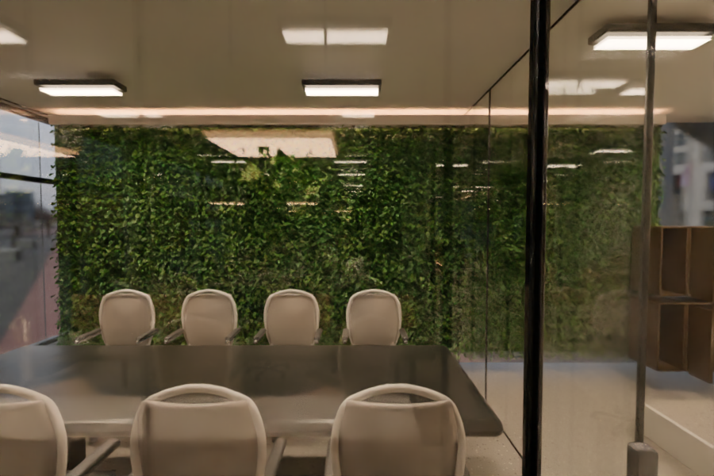
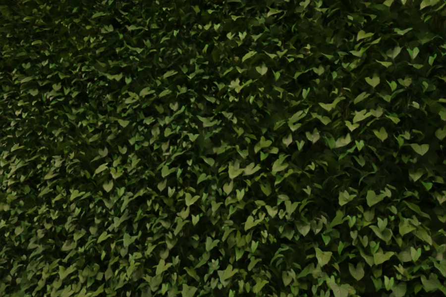
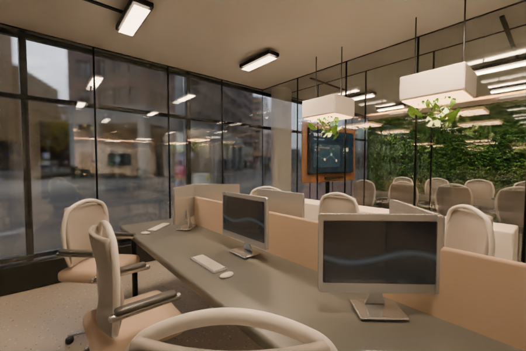

# Pruebas de acabado — candidato en proceso

**Maestro:** [office-phase04-revision.blend](../../simulation/spatial-office/output/office-phase04-revision.blend).

Cuatro mesas y catorce sillas de comedor, más cuatro taburetes; sillas blancas de visita sustituidas por dos sofás; lounge equipado; pantalla grande de reuniones; baño y cabinas identificados.

**Gate:** 678 comprobaciones / 21 recorridos. **71 luces en 17 circuitos**, luz de trabajo a 3200 K y acentos a 2700 K; 135 piezas de vidrio con reflexión/transmisión. Arquitectura y posiciones heredadas conservadas. [Plano con baño/cabinas](evidence/phase04-revision/layout-with-ids.svg) · [Informe](PHASE-04-REVISION-REPORT.md).

Las imágenes siguientes son renders reales de este maestro, con filtrado OIDN y pases de albedo/normales. Las referencias del operador son objetivos visuales; nunca sustituyen capturas. Aceptación humana pendiente.

**Borradores de 900 × 600 / hasta 24 muestras. Las capturas de revisión de mayor resolución están pendientes.**

## Jardín vertical: cobertura completa

[Original Cycles sin filtrar](evidence/phase04-revision/draft/vertical-garden.png) · hora 12:00 · [900, 600] · hasta 24 muestras.

## Jardín vertical a escala cercana

[Original Cycles sin filtrar](evidence/phase04-revision/draft/garden-detail.png) · hora 12:00 · [900, 600] · hasta 24 muestras.

## Puestos: vidrio, equipos y jardineras

[Original Cycles sin filtrar](evidence/phase04-revision/draft/office.png) · hora 12:00 · [900, 600] · hasta 24 muestras.

## Objetivos visuales proporcionados por el operador

| Lounge | Puestos | Recepción |
|---|---|---|
|  |  |  |

Revisar textura, diseño de luz cálida, reflejos del vidrio y detalle a escala humana. Son referencias de calidad, no evidencia de la escena ejecutada.

Para abrir los controles locales, ejecutar el texto **START ENTITY visual controls** dentro del maestro en el checkout. La integración PlayCanvas y la exportación arquitectónica definitiva siguen pendientes de autorización tras esta revisión.
