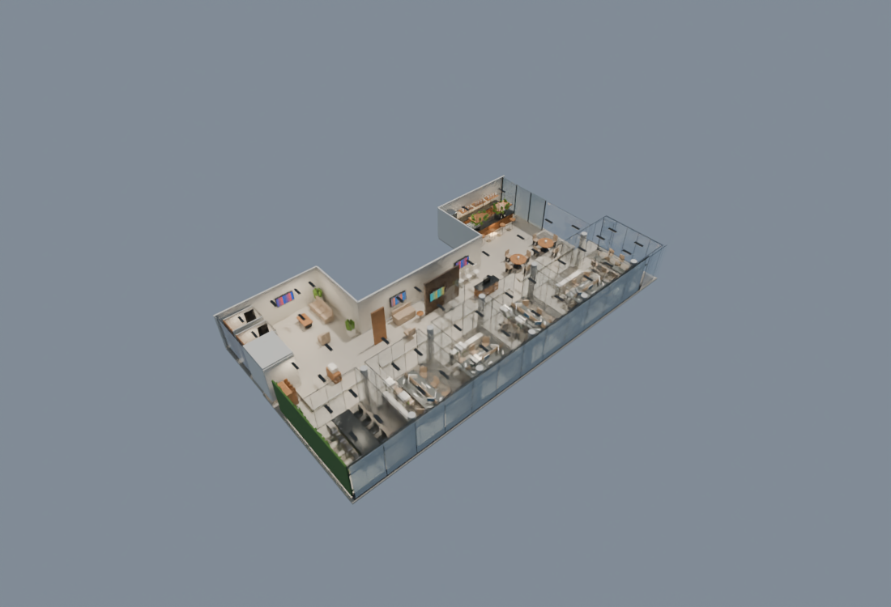
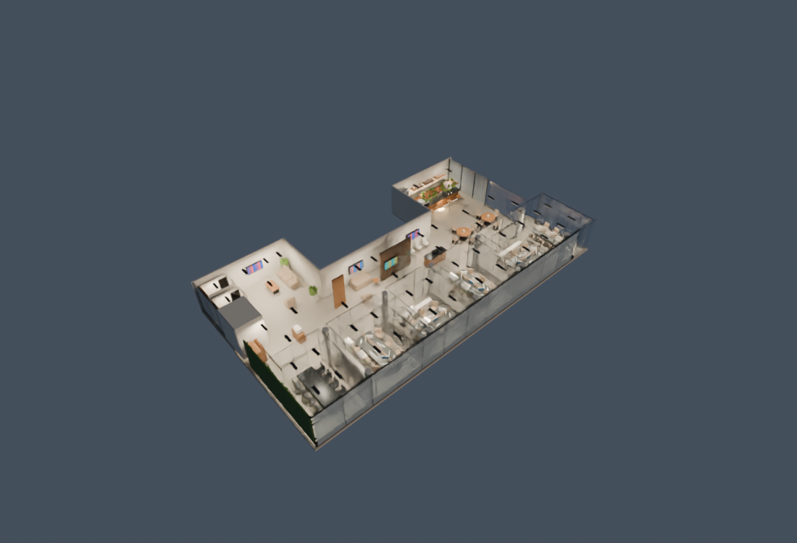
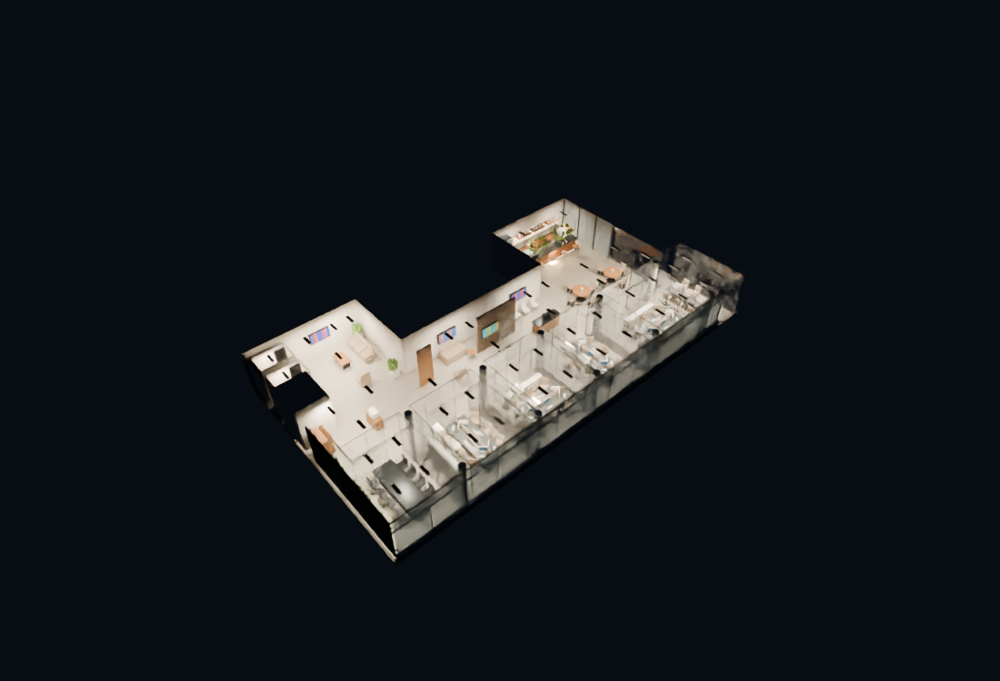
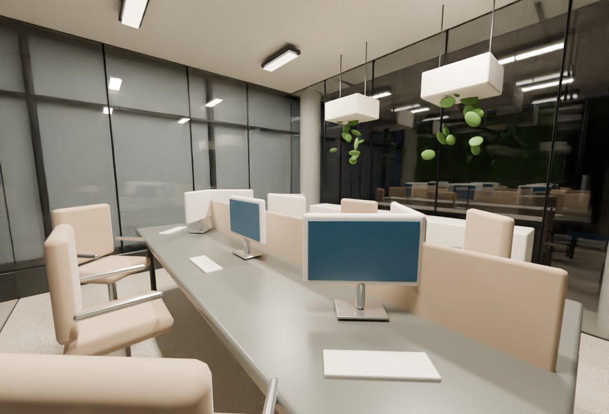
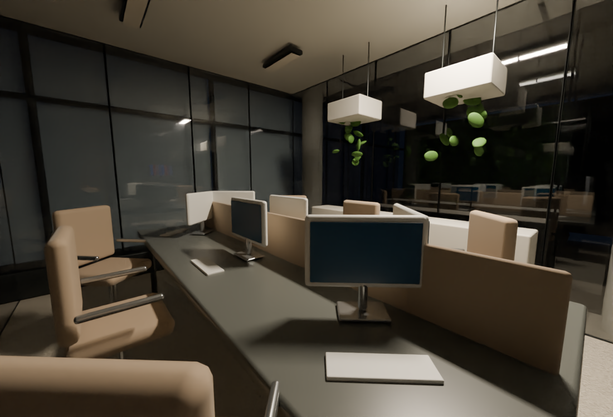
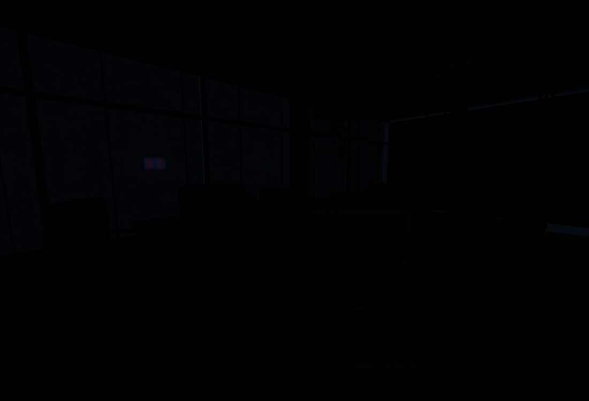
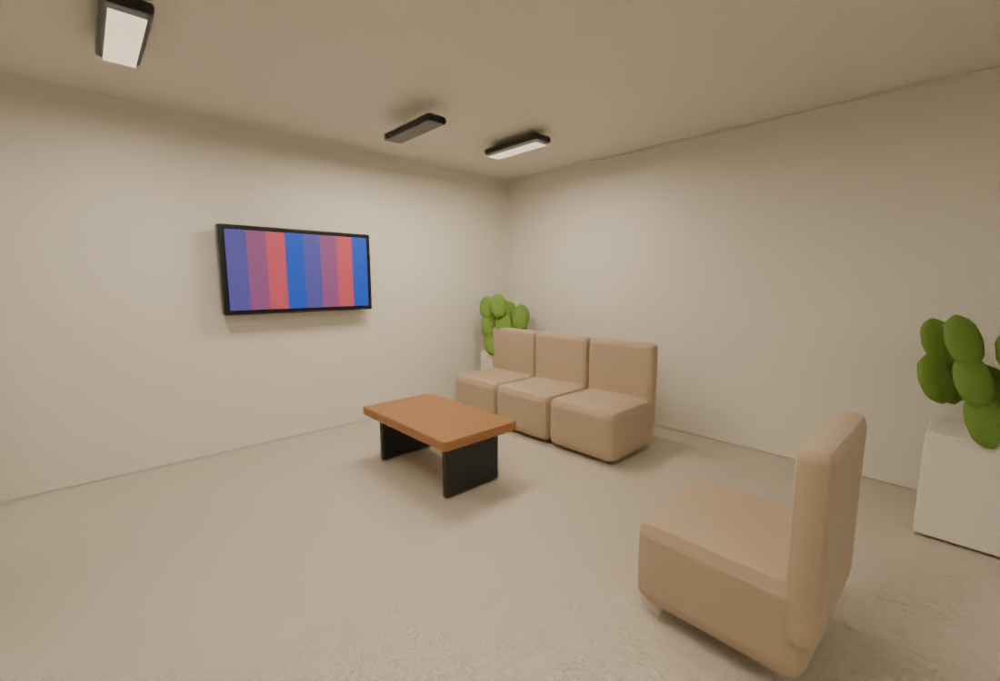
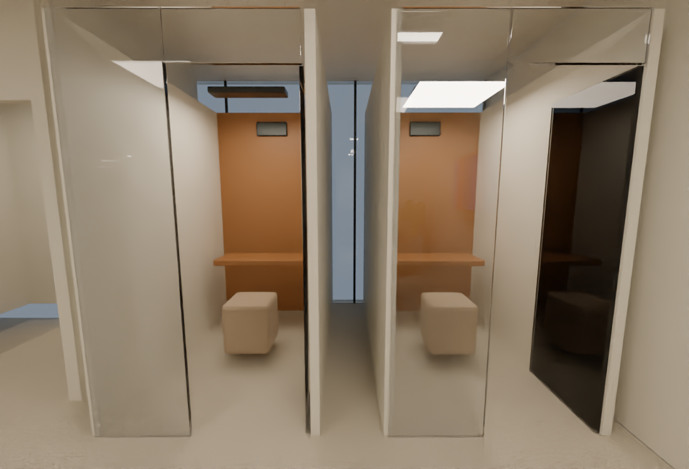
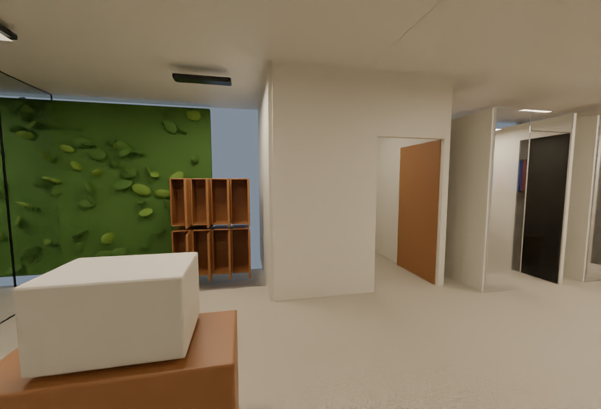

# Revisión del operador — Blender hasta Fase 04

**Maestro actual:** [office-phase04.blend](../../simulation/spatial-office/output/office-phase04.blend).

La distribución actual es una **C**: A–E y reuniones en el cuerpo principal, cafetería en el ala posterior, lounge/cabinas/baños/lockers en la nueva ala frontal. **E es la agrupación adicional al fondo**. Recepción está en el sector de sillas blancas; espera, con sofá, en el antiguo sector de sillas negras. Las dimensiones añadidas siguen siendo estimadas.

[Plano con IDs y recorridos](evidence/phase03/layout-with-ids.svg) · [Informe y pruebas](PHASE-04-REPORT.md) · [Manifest de dispositivos](../../simulation/spatial-office/output/device-manifest.json).

## Horarios simulados

Son referencias visuales, no la hora real ni un sol geográfico certificado. Las coordenadas del edificio permanecen desconocidas. Cada imagen de revisión tiene una versión original Cycles sin filtrar, conservada con su hash.

| 08:00 | 12:00 |
|---|---|
|  |  |
| [Original](evidence/phase04/time-08.png) | [Original](evidence/phase04/time-12.png) |

| 16:00 | 20:00 |
|---|---|
|  |  |
| [Original](evidence/phase04/time-16.png) | [Original](evidence/phase04/time-20.png) |

## La misma sala, el mismo cielo y la misma cámara

Sala A a las 20:00. Se apagan las demás luminarias para aislar el aporte de A. Las pantallas son independientes. El filtrado de ruido no modifica posiciones ni crea objetos; los originales están disponibles debajo.

**Todas las luces de A encendidas**

**Una sola luminaria encendida**

**Todas las luces de A apagadas**

[Original ON](evidence/phase04/room-A-all-on-20.png) · [Original una ON](evidence/phase04/room-A-one-on-20.png) · [Original OFF](evidence/phase04/room-A-all-off-20.png).

## Ala social y servicios

**Lounge**, diferente de cafetería:

**Dos cabinas** con puerta, repisa, asiento, ventilación y luz propios:

**Baños opacos y lockers juntos**, con impresión al lado. Sin cámaras ni personas dentro de baños:

## Cómo probarlo

Abrir el maestro en Blender, ejecutar su texto **START ENTITY visual controls** y abrir la pestaña **ENTITY** de la barra lateral **N**. Hay hora, avance/retroceso, velocidad, pausa, circuitos, niveles, luces individuales y selección de puertas. Es control local simulado; no actúa sobre hardware ni genera observaciones Core.

Las pruebas y renders están ejecutados; la **aceptación visual sigue siendo del operador**. Según el plan, la implementación del visor PlayCanvas y la exportación definitiva del edificio esperan aprobación después de esta revisión. Mixamo también queda para su fase autorizada posterior.
