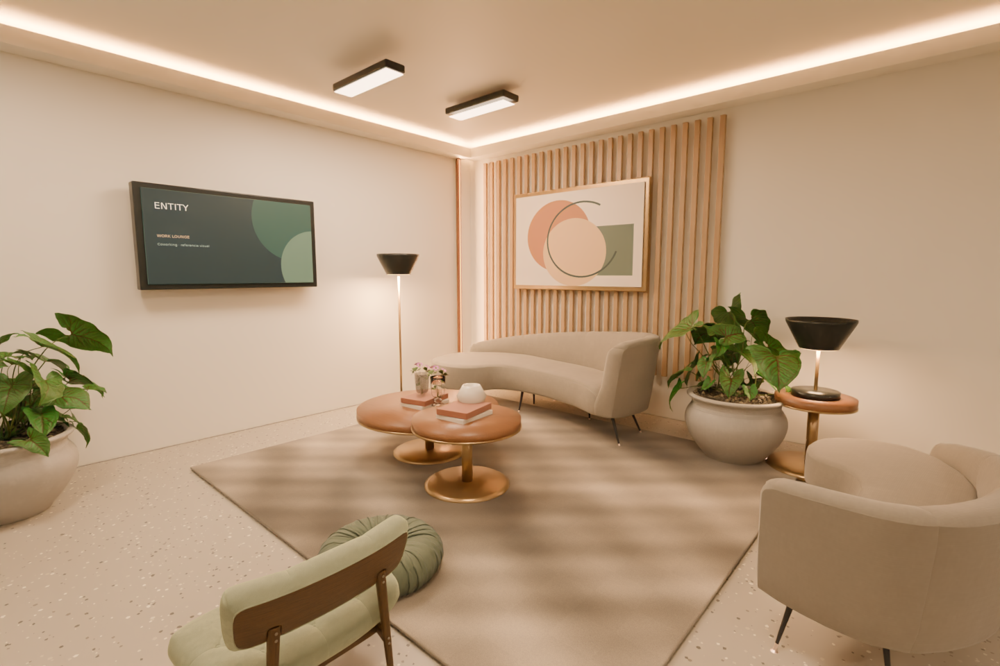
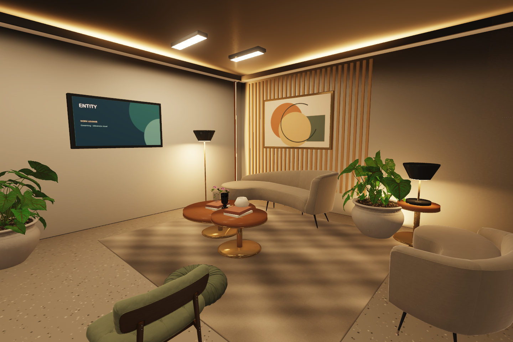

# Comparación Fase05 — todavía no aceptada

Mismo maestro aprobado, cámara revision-lounge, 12:00 y 1440 × 960. Captura real del canvas PlayCanvas, sin retoque.

| Blender aprobado | PlayCanvas actual |
|---|---|
|  |  |

Se recuperaron techos/remates, recolor de macetas, instancias visibles, tangentes, conversión lineal/sRGB de luces/emisores, materiales de vidrio importados, HDR y reflejos locales. Se corrigió el destino UV de los lightmaps. Maestro original intacto.

**La referencia aún no está igualada.** El techo continúa demasiado oscuro, el rebote resulta insuficiente y la respuesta de mesas/metales y las sombras difiere de Cycles. No se presenta esta captura como calidad premium aprobada. Debe continuar el ciclo de diagnóstico y comparación en todos los ambientes.

Dos bases HDR separan ambiente e indirecta artificial. La indirecta artificial responde por promedio de circuito; no representa una solución exacta por lámpara. El aporte directo sigue individual. Todos los perfiles conservan escala de render 1 y texturas completas.

Cinco pruebas funcionales unitarias PASS; auditoría de materiales/IDs y protección de originales PASS. Las pruebas de navegador completas se interrumpieron para corregir calidad. Renderizado mediante SwiftShader: no demuestra 30 FPS en hardware móvil. La medición de memoria de la captura registra unos 236 MB de texturas GPU estimadas; el FPS del bucle en reposo no se considera rendimiento de navegación. Validación física móvil pendiente.

Gate05 permanece ABIERTO. No se inicia Fase06.
