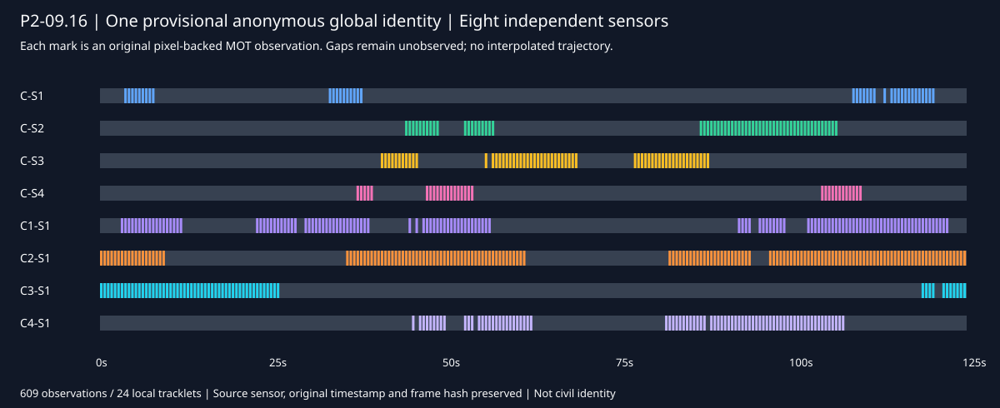

# P2-09.16 — Continuidad global anónima con evidencia espacial

## Propósito y alcance

ENTITY debe mantener una misma hipótesis de entidad cuando cambia el sensor o falta visibilidad. Cada cámara conserva su identidad, reloj, calibración y evidencia. El grafo restringe dónde podría desplazarse una persona; no sabe dónde está realmente. OSNet aporta apariencia, no identidad civil. El conocimiento del evaluador de que existe un solo actor nunca se proporciona al algoritmo ni fija la cantidad de grupos.

Esta ejecución consume el corpus09.14 y los tracks09.15, sin recapturarlos ni modificar el baseline09.1–09.9. El adaptador reutiliza OSNet-AIN x1.0 y sus pesos/export local verificados en09.10; no crea otro detector ni otro Core. La adaptación compartida está en P1 Edge; P2 conserva escenario, configuración y evaluación. No hay integración Core nueva en esta fase.

## Resultado verificable

- Una hipótesis global anónima conecta24tracks locales de ocho sensores. C no es un panorama: sus cuatro cabezales siguen siendo fuentes independientes.
-609observaciones originales conservadas exactamente con sensor, IDlocal, caja, confianza, hash y tiempo original; la confirmación posterior del MOT mantiene sus tiempos separados.
-502/513oportunidades válidas asociadas, igual que el MOT09.15; cero fragmentaciones globales residuales del actor. No se inventan detecciones para cubrir pérdidas.
-186asociaciones provisionales de apariencia/geometría. No son186personas ni probabilidades calibradas.
-229instantes con soporte geométrico conjunto comprobado; cuatro instantes (37.5,38,38.5,55.5s) quedan sin resolver por desacuerdo de proyecciones. Cero segmentos temporalmente inviables en la comprobación conservadora. Mayor intervalo entre evidencias geométricas retenidas:8.5s; no es una trayectoria observada ni prueba de una posición concreta durante el intervalo.
-Las cuatro observaciones falsas/de localización/duplicadas de09.15 siguen asociadas: no se ocultan ni se filtran usando etiquetas. Un único actor no permite estimar la tasa de fusiones falsas entre personas diferentes.
-34pruebas Edge,13nuevas de MTMC; auditoría real OSNet+MTMC en96frames/33observaciones, con evaluador presente fuera del trabajador, desconectado y con IDprivado cambiado. Descriptores, fuentes y asociaciones idénticos; originales restaurados.

El cierre formal está en `gate.json`; evaluación agregada en `evaluation.json`, pruebas en `test-results.json` y aislamiento en `isolation.json`. Los tiempos medidos definitivos están en el JSON de evaluación. Es un proceso batch: la asociación global puede utilizar evidencia posterior hasta el final del corpus, y se declara su instante de disponibilidad. No acredita identidad global instantánea ni tiempo real. El detector09.15 ya era inferior a16imágenes/s agregadas; no se elimina ese límite.



## Qué cambió y por qué

El MTMC histórico solo enlazaba observaciones simultáneas y generaba componentes sin comprobar contradicciones transitivas. Se conserva intacto. El nuevo adaptador compara solapamientos y reapariciones, incluyendo tracks distintos del mismo sensor cuando no coinciden temporalmente. Una coincidencia fuerte de apariencia nunca anula una barrera, una velocidad imposible o dos tracks simultáneos incompatibles del mismo sensor. Antes de unir componentes se revisan contradicciones entre todos sus miembros. Alternativas incompatibles de puntuación similar permanecen inciertas.

El primer ensayo produjo tres grupos al usar un punto de suelo y su celda más cercana. Cambiarlo por regiones alrededor del punto produjo cuatro: el problema no era solo la discretización. Las imágenes/cajas permitidas mostraron pies o cuerpos truncados y ocluidos; el edificio contiene suelos a-1.85 y-1.55 y una transición. Proyectar el borde inferior de toda caja contra un único plano inventaba precisión y falsas desconexiones. Estos diagnósticos se hicieron con imágenes, cajas, calibración y geometría estática, antes de consultar las etiquetas del evaluador.

La inferencia final proyecta una columna vertical genérica desde cada celda transitable y conserva los soportes compatibles con la caja observada. Usa una cota genérica de2.0unidades nativas y muestras verticales, no la altura/pose del dummy. El tamaño proyectado debe ser al menos0.65de la altura de caja; la banda horizontal central es70% y la expansión vertical10%. Son priors de ingeniería no certificados, conservadores ante oclusión. Las regiones pueden ser amplias o desconectadas; ninguna celda se presenta como posición observada.

En vistas simultáneas se exige apariencia mediana>=0.60 y compatibilidad geométrica en>=60%de al menos tres pares conocidos. Una incompatibilidad en>80%de esos pares es contradicción. En una reaparición se exige apariencia>=0.65 y existencia de camino entre soportes de frontera al máximo1.4unidades nativas/s del grafo; no hay un tiempo máximo arbitrario de pausa. Se conservan direcciones estimadas de frontera como inciertas: un giro o una parada no se rechaza por una dirección proyectada ruidosa. La dirección y longitud del camino pertenecen a la hipótesis geométrica, no a un movimiento observado.

Además de los pares se comprueba la secuencia completa: intersección de soportes de las vistas compatibles en cada instante y propagación de alcanzabilidad por el grafo entre instantes observados. Si las vistas discrepan, se registra el instante sin resolver; no se elige una cámara usando GT. Las pruebas incluyen un salto imposible dentro de un único track local, de modo que no basta con confiar en el MOT.

La identidad anónima se ancla a la evidencia original más temprana, no al listado completo de miembros: añadir evidencia posterior no la renombra. El resultado conserva hipótesis revisables; no crea Person, no identifica a Juan, no declara ocupación de una silla ni actualiza reservas, cobros o pagos. La persistencia de estas asociaciones en el mismo Core corresponde a09.17.

## Reproducción local

Prerequisitos: entorno09.10, pesos OSNet locales verificados, corpus09.14 en `/opt/entity-p2/corpora/trial-a/frames` y salida09.15 en `.runtime/cctv-trial-trial-a/output/tiles025`. Los PNG históricos no son necesarios. No se descargan cámaras físicas ni se requieren credenciales externas.

Desde la raíz del repositorio en WSL:

```bash
/opt/entity-p2/cpu-venv/bin/python scripts/spatial-simulation/perception/validate-cctv-mtmc.py
```

El supervisor ejecuta OSNet y MTMC aislados, las34pruebas Edge, el evaluador posterior y la auditoría de separación, y solo escribe un gate positivo si todo pasa. Inferencia: Bubblewrap sin red ni workspace/evaluador; mounts de frames, pesos, calibración, grafo, código/contratos y salida. El evaluador no se importa ni monta en el trabajador. Las rutas de imagen y sus SHA se validan; campos de actor o mezclas sensor/track se rechazan.

Archivos privados: embeddings, recortes/frameoriginales, asociaciones porobservación, labels/GT y logs bajo`.runtime`; no se publican. La evidencia pública contiene agregados y una línea temporal construida únicamente con observaciones del modelo. `evaluation.json` es salida del evaluador posterior, no entrada de inferencia. `continuity.svg` no contiene GT.

## Límites y siguiente fase

Un corpus de ajuste y un actor; no demuestra discriminación multipersona, cinco ensayos independientes ni aceptación humana. Las regiones de soporte usan priors no calibrados y toleran incertidumbre: demostrar un camino factible no demuestra recuperar la trayectoria real. Cuatro instantes sin resolver y cuatro observaciones falsas/de localización/duplicadas siguen explícitos. Las pruebas unitarias negativas no equivalen a un ensayo multipersona, que no está autorizado todavía.09.17 debe comprobar el mismo Core, relaciones/estado/memoria, trazabilidad, idempotencia y rendimiento;09.18 exige cinco recorridos y aceptación humana final.
