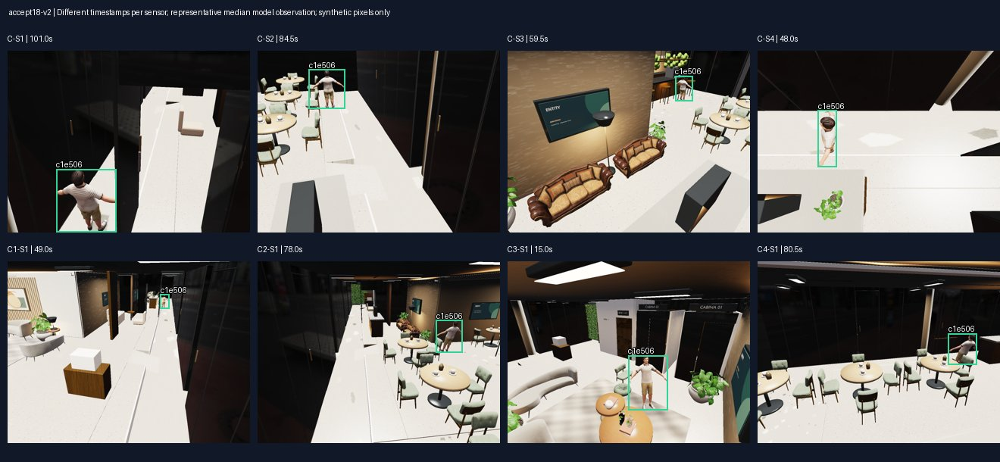
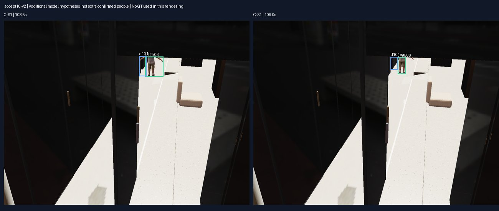
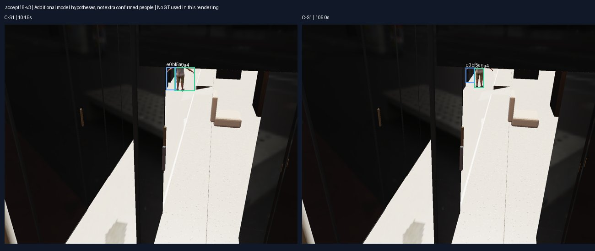

# P2-09.18 — Cinco repeticiones para revisión humana

**Estado:** controles técnicos de las cinco ejecuciones superados; aceptación humana pendiente.

Se capturaron de nuevo **9288 imágenes**. El detector encontró2310/2350oportunidades ópticas válidas (98.30%agregado). El gate se exige en cada ejecución: un promedio no sustituye un ensayo fallido.

| Ensayo | Imágenes | Recall | FP detector | FP/duplicados MOT | Cambios ID local | IDs del actor | Hipótesis globales totales | Fragmentaciones | Geometría sin resolver | Core |
|---|---:|---:|---:|---:|---:|---:|---:|---:|---:|---|
| [accept18-v0](accept18-v0/evaluation.json) | 2008 | 98.05% | 8 | 4 | 0 | 1 | 1 | 0 | 4 | PASS |
| [accept18-v1](accept18-v1/evaluation.json) | 1928 | 98.35% | 8 | 4 | 0 | 1 | 1 | 0 | 4 | PASS |
| [accept18-v2](accept18-v2/evaluation.json) | 1848 | 98.08% | 9 | 5 | 0 | 1 | 2 | 0 | 4 | PASS |
| [accept18-v3](accept18-v3/evaluation.json) | 1784 | 98.88% | 10 | 4 | 0 | 1 | 2 | 0 | 2 | PASS |
| [accept18-v4](accept18-v4/evaluation.json) | 1720 | 98.16% | 12 | 6 | 0 | 1 | 1 | 0 | 5 | PASS |

## Qué se ha comprobado

Cada ensayo mantiene una identidad visual del actor entre ocho sensores independientes. **v2 y v3 conservan además una hipótesis global espuria/duplicada cada uno: Core contiene2grupos en esos ensayos, no una segunda persona real.** v2 incluye dos observaciones sin soporte del actor; v3 contiene un track duplicado del mismo sensor/instante. No se eliminan usando GT. El gate de continuidad cuenta la identidad del actor; la tabla informa también todas las hipótesis y falsos positivos. El grafo restringe desplazamientos posibles y la apariencia aporta evidencia; compartir cámara o estar conectado en el grafo operativo no convierte dos tracks en una misma persona. Las relaciones de identidad son tipadas y provisionales. No se proporciona al algoritmo la cantidad esperada de actores.

Se conservaron sensor, timestamp original, hash y detección que soporta cada observación. Los intervalos sin vista no se rellenan como trayectoria observada. Las discrepancias de geometría permanecen explícitas; los falsos positivos/duplicados se cuentan y no se eliminan usando etiquetas. La posición global sigue desconocida en Core.

Los cinco corpus ingresan al mismo sitio/SQLite de P1, en runs separados. En cada uno se consulta grafo/memoria, se repiten exactamente los mensajes sin nuevos efectos y se reinicia el proceso HTTP comprobando mundo/relaciones/memoria. Las personas previas y los mundos históricos permanecen iguales. No se crean personas civiles, reservas, pagos ni ocupación de puestos.

La política de percepción, modelos, calibración y grafo quedaron congelados antes de evaluar los cinco corpus; ver [frozen-policy.json](frozen-policy.json). Los117testsCore y34Edge están en [test-results.json](test-results.json). Se optimizó únicamente el replay exacto de Core: mantiene autorización y conflicto de IDs, y evita reconstruir el mundo para un mensaje ya validado.

## Evidencia visual para revisar

Las láminas contienen píxeles sintéticos originales y cajas/IDs del modelo, sin GT. Cada sensor tiene un timestamp diferente, indicado en la imagen: no es una captura simultánea. Las líneas temporales muestran observaciones reales del modelo, sin interpolación.

### accept18-v0

[Continuidad temporal](accept18-v0/continuity.svg) · [Core y replay](accept18-v0/persistence.json) · [Ingreso HTTP](accept18-v0/ingestion.json)

### accept18-v1

[Continuidad temporal](accept18-v1/continuity.svg) · [Core y replay](accept18-v1/persistence.json) · [Ingreso HTTP](accept18-v1/ingestion.json)

### accept18-v2

[Continuidad temporal](accept18-v2/continuity.svg) · [Core y replay](accept18-v2/persistence.json) · [Ingreso HTTP](accept18-v2/ingestion.json)

### accept18-v3

[Continuidad temporal](accept18-v3/continuity.svg) · [Core y replay](accept18-v3/persistence.json) · [Ingreso HTTP](accept18-v3/ingestion.json)

### accept18-v4

[Continuidad temporal](accept18-v4/continuity.svg) · [Core y replay](accept18-v4/persistence.json) · [Ingreso HTTP](accept18-v4/ingestion.json)

## Reproducción y separación

El planificador del simulador produce cinco variantes del estímulo(0–4), con velocidades1.0–1.2unidades nativas/s, pausas, giros, oclusiones y reapariciones. capture-acceptance.ps1 abre sesiones nativas de navegador nuevas y conserva corpus completos. validate-cctv-acceptance.py encadena trabajadores Bubblewrap sin red/workspace/evaluador, evaluación posterior y una cola serial de ingresos Core. El evaluador mantiene sus etiquetas y referencias en un directorio/caché privado diferente, nunca montado en ENTITY.

Los cinco ingresos originales se detuvieron por una validación incorrecta de metadatos heredados: un run nuevo hereda el hash del corpus anterior desde el inventario del sitio, pero aún no tiene observaciones. Se corrige el enrolamiento del corpus nuevo; el cold guard protege runs existentes y el replay exige el hash original. Los intentos fallidos quedan conservados. resume-cctv-acceptance-core.py repite solo Core en IDs-r2, con las mismas salidas de percepción. No se recaptura ni reajusta el modelo usando GT.

La inferencia y evaluación ya completadas no deben repetirse para reanudar. Consultar una vez los marcadores privados accept18-capture-status.json, accept18-validation-status.json y accept18-core-resume-status.json y los JSON públicos. Si un supervisor sigue activo, no lanzar una segunda copia. Los scripts rechazan sobrescrituras de corpus y modificaciones de la política congelada.

## Límites y aceptación pendiente

Son cinco capturas/ejecuciones nuevas del mismo recorrido geométrico, con distinta velocidad. La variante0 repite el estímulo de ajuste; no son cinco edificios o rutas inéditas ni una prueba estadística de generalización. Un actor no permite medir falsas fusiones multipersona. El dummy está en pose de validación, no es el personaje final animado.

El circuito es batch, no causal en vivo ni tiempo real. Los tiempos combinados del reintento Core suman procesamiento de inferencia registrado e ingreso nuevo; no son walltime de un único intento. No se inventa precisión mundial, identidad civil ni ocupación de una silla. Persistir una inferencia no elimina sus falsos positivos.

**La aceptación humana final no está otorgada.** Revisar si la continuidad, las fuentes, las pérdidas/reapariciones y los límites documentados son aceptables para cerrar P2-09. No iniciar múltiples personas ni P3 sin nueva autorización.
